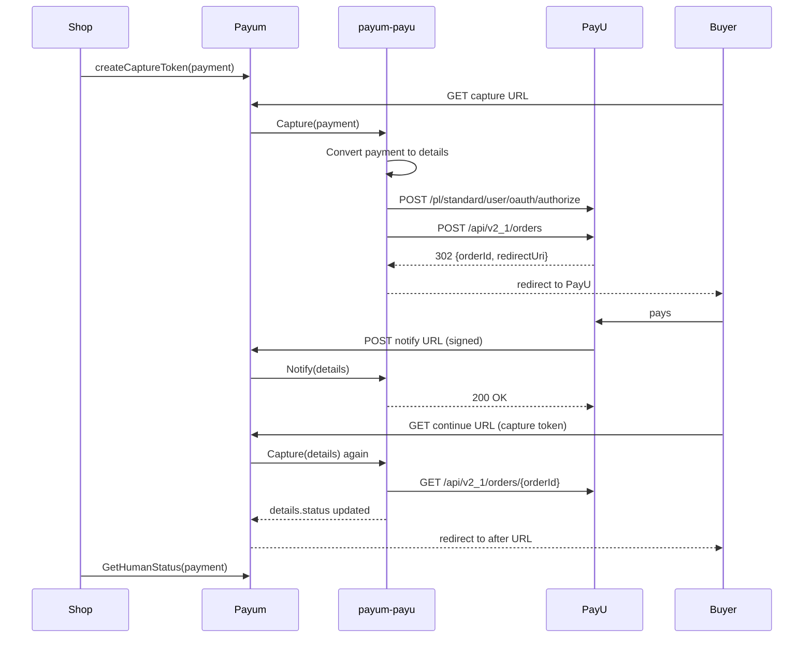

# Payment flow

## 1. Create the payment

Any `Payum\Core\Model\PaymentInterface` works. The conversion step copies these fields into the details:

| Payment getter | Detail key | PayU field |
| --- | --- | --- |
| `getTotalAmount()` | `totalAmount` | `totalAmount` (minor units) |
| `getCurrencyCode()` | `currencyCode` | `currencyCode` |
| `getNumber()` | `extOrderId` | `extOrderId` (must be unique per POS) |
| `getDescription()` | `description` | `description` and the default product name |
| `getClientEmail()` | `clientEmail` | `buyer.email` |
| `getClientId()` | `clientId` | `buyer.extCustomerId` |

Details already present on the payment are kept, so set buyer name, language, products, validity time, recurring mode
or a pay method before capturing. See [details-reference.md](details-reference.md).

## 2. Capture

The `Capture` action runs twice. On the first run there is no `orderId` yet, so it executes `CreateOrder`:

1. The buyer IP comes from `details.customerIp` or, when missing, from Payum's `GetHttpRequest`. Server-side charges
   (recurring) must set it explicitly; the package never invents one.
2. A `STANDARD` recurring charge without a pay method looks up the buyer's stored card tokens
   ([recurring-payments.md](recurring-payments.md)).
3. The order is posted with `continueUrl` = the capture token target URL and `notifyUrl` = a fresh notify token.
4. `orderId`, `status` (`NEW` unless already set), `cardMaskedNumber` and `redirectUri` are stored.
5. When PayU returns a `redirectUri`, the buyer is redirected (`Payum\Core\Reply\HttpRedirect`). Otherwise the payment
   was settled synchronously (card token) and the order is synchronised immediately.

When the buyer comes back to the continue URL, the capture token is replayed; now `orderId` exists, so `Sync` fetches
the order and updates `status` and `payMethodType`.

## 3. Read the status

`GetHumanStatus` (or `GetBinaryStatus`) maps the details as follows:

| Details | Payum status |
| --- | --- |
| `refund.status = FINALIZED` | refunded |
| no status or `NEW` | new |
| `PENDING`, `WAITING_FOR_CONFIRMATION` | pending |
| `COMPLETED` | captured |
| `CANCELED` | canceled |
| any other stored value | unknown |

A `WAITING_FOR_CONFIRMATION` order needs a manual decision in the PayU panel (or an API call) and will later move to
`COMPLETED` or `CANCELED` through a notification.

## Errors

| Exception | Meaning |
| --- | --- |
| `PayumPayU\Rest\Exception\TransportException` | The HTTP client could not deliver the request. Retry is reasonable. |
| `PayumPayU\Rest\Exception\ApiException` | PayU rejected the request; `->status` carries the PayU status code and description, `->httpStatusCode` the HTTP code. |
| `PayumPayU\Rest\Exception\InvalidResponseException` | The body was not the JSON this package expects. |
| `PayumPayU\Model\Exception\MissingDetailException` | A required detail is missing (for example `customerIp`). Programming error, not retryable. |
| `PayumPayU\Recurring\Exception\CardTokenNotFoundException` | No usable stored card for a `STANDARD` recurring charge. |

Every exception implements `PayumPayU\Exception\ExceptionInterface`.
